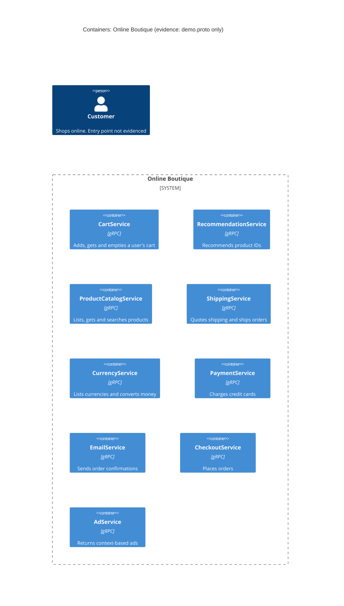

# Task 1, Run A: Recovered architecture (evidence: `demo.proto` only)

## 1. Agent

Claude Code (Anthropic), model Claude Opus 5.5 (`claude-opus-5-5`).

## 2. Files read

- `prompts/1-recover-architecture.md` (task instructions)
- `system/online-boutique/protos/demo.proto` (the only evidence file)

## 3. Containers table

All containers below come from `service` definitions in the proto file. The proto file defines **interfaces only**, so the implementation language and runtime of each service are **not evidenced**. The interface technology is gRPC / Protocol Buffers (`syntax = "proto3"`, line 15; `service … rpc …` blocks).

| Container | Technology / language | Responsibility (from RPCs) | Evidence |
|---|---|---|---|
| CartService | gRPC (proto3); language not evidenced | Add items to a user's cart, get the cart, empty it (`AddItem`, `GetCart`, `EmptyCart`) | `system/online-boutique/protos/demo.proto` (`service CartService`, lines 23–27) |
| RecommendationService | gRPC (proto3); language not evidenced | Recommend product IDs for a user and a list of products (`ListRecommendations`) | `system/online-boutique/protos/demo.proto` (`service RecommendationService`, lines 56–58) |
| ProductCatalogService | gRPC (proto3); language not evidenced | List, get and search products (`ListProducts`, `GetProduct`, `SearchProducts`) | `system/online-boutique/protos/demo.proto` (`service ProductCatalogService`, lines 71–75) |
| ShippingService | gRPC (proto3); language not evidenced | Quote shipping cost and ship an order, returning a tracking ID (`GetQuote`, `ShipOrder`) | `system/online-boutique/protos/demo.proto` (`service ShippingService`, lines 107–110) |
| CurrencyService | gRPC (proto3); language not evidenced | List supported currencies and convert money between them (`GetSupportedCurrencies`, `Convert`) | `system/online-boutique/protos/demo.proto` (`service CurrencyService`, lines 140–143) |
| PaymentService | gRPC (proto3); language not evidenced | Charge a credit card and return a transaction ID (`Charge`) | `system/online-boutique/protos/demo.proto` (`service PaymentService`, lines 177–179) |
| EmailService | gRPC (proto3); language not evidenced | Send an order confirmation email (`SendOrderConfirmation`) | `system/online-boutique/protos/demo.proto` (`service EmailService`, lines 199–201) |
| CheckoutService | gRPC (proto3); language not evidenced | Place an order and return the order result (`PlaceOrder`) | `system/online-boutique/protos/demo.proto` (`service CheckoutService`, lines 224–226) |
| AdService | gRPC (proto3); language not evidenced | Return text ads for page context keywords (`GetAds`) | `system/online-boutique/protos/demo.proto` (`service AdService`, lines 243–245) |

Data stores: **Not evidenced in the provided files.** No database, cache or message broker appears in the proto file.

## 4. Dependencies table

| Caller → callee | Protocol | Evidence |
|---|---|---|
| None evidenced | – | `demo.proto` declares which RPCs each service **offers**. It never says which service **calls** which. Runtime dependencies are not evidenced in the provided files. |

Candidate dependencies that the message types suggest are listed under **Gaps** as [Inferred]. They are not in the diagram.

## 5. Mermaid diagram

The diagram has no `Rel` lines because the dependencies table has no rows. The `Person` is shown because the template requires one. The evidence does not show how the end user reaches the system (see **Gaps**).

## 6. Gaps

| Gap | Why `demo.proto` can't settle it | Extra file that would settle it |
|---|---|---|
| **Who calls whom** (all runtime dependencies) | The proto only defines server interfaces, with no client wiring | Deployment config that gives each service its callees' addresses, e.g. `system/online-boutique/kubernetes-manifests/frontend.yaml` (`CART_SERVICE_ADDR`) and the other manifests in that folder. The caller's source code would confirm the actual calls |
| **User-facing entry point** (web frontend / HTTP) | The proto has no frontend service and no HTTP API | `system/online-boutique/kubernetes-manifests/frontend.yaml`, plus the frontend source code |
| **Implementation language of each service** | `option go_package` (line 19) only names the Go package for *generated* stubs. It says nothing about the language of each server | Each service's Dockerfile or build file under the service source folders [path not verified] |
| **Data stores** (e.g. where carts are kept) | `Cart` (lines 47–50) is keyed by `user_id`, so cart state must persist across calls, but no store is named | The cart service's source/config and the Kubernetes manifests (a database or cache deployment, and an address env var for it) |
| **External systems** (real payment gateway, real email provider) | `Charge` and `SendOrderConfirmation` exist, but the proto doesn't show whether they call outside systems or are mocks | `paymentservice` and `emailservice` source code [path not verified] |
| **Message brokers / async communication** | Every RPC is unary request–response. Nothing shows events or queues | Kubernetes manifests (any broker deployment) and the service source code |

**[Inferred] candidate dependencies (from shared message types, not proven):**

- `CheckoutService → PaymentService`: `PlaceOrderRequest.credit_card` (line 234) is the same `CreditCardInfo` type as `ChargeRequest.credit_card` (line 190).
- `CheckoutService → ShippingService`: `PlaceOrderRequest.address` (line 232) is the type `ShipOrderRequest` needs (line 122), and `OrderResult.shipping_tracking_id` (line 210) matches `ShipOrderResponse.tracking_id` (line 127).
- `CheckoutService → EmailService`: `PlaceOrderRequest.email` (line 233) plus `OrderResult` (line 238) are exactly what `SendOrderConfirmationRequest` holds (lines 216–219).
- `CheckoutService → CurrencyService`: `PlaceOrderRequest.user_currency` (line 230) suggests prices are converted with `Convert` (line 142).
- `CheckoutService → CartService`: `PlaceOrderRequest` carries `user_id` (line 229) but no items, so the items probably come from `GetCart` (line 25) and the cart is then cleared with `EmptyCart` (line 26).
- `RecommendationService → ProductCatalogService`: recommendations return product IDs (line 66), so the service may need the catalog to choose candidates.
- A frontend (not in the proto) probably calls `CartService`, `ProductCatalogService`, `CurrencyService`, `RecommendationService`, `AdService`, `ShippingService` (`GetQuote`) and `CheckoutService`.
