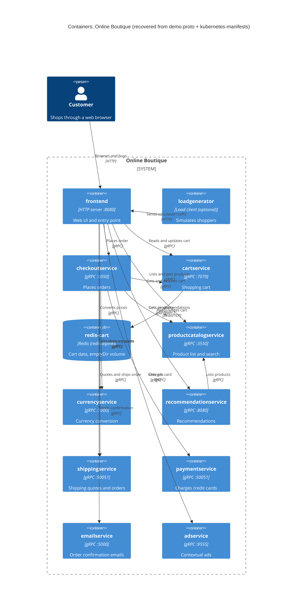

# Task 1 · Run B: Recovered container architecture (Online Boutique)

## 1. Agent

Claude Code (Anthropic CLI), model **Claude Opus 5.5** (`claude-opus-5-5`).

## 2. Files read

Task file: `prompts/1-recover-architecture.md`

Evidence:

- `system/online-boutique/protos/demo.proto`
- `system/online-boutique/kubernetes-manifests/README.md`
- `system/online-boutique/kubernetes-manifests/kustomization.yaml`
- `system/online-boutique/kubernetes-manifests/adservice.yaml`
- `system/online-boutique/kubernetes-manifests/cartservice.yaml`
- `system/online-boutique/kubernetes-manifests/checkoutservice.yaml`
- `system/online-boutique/kubernetes-manifests/currencyservice.yaml`
- `system/online-boutique/kubernetes-manifests/emailservice.yaml`
- `system/online-boutique/kubernetes-manifests/frontend.yaml`
- `system/online-boutique/kubernetes-manifests/loadgenerator.yaml`
- `system/online-boutique/kubernetes-manifests/paymentservice.yaml`
- `system/online-boutique/kubernetes-manifests/productcatalogservice.yaml`
- `system/online-boutique/kubernetes-manifests/recommendationservice.yaml`
- `system/online-boutique/kubernetes-manifests/shippingservice.yaml`

> Note: The manifests use only image names (e.g. `image: cartservice`). They give **no programming language** for any service. The "Technology" column therefore shows the protocol and runtime that the manifests *do* show.

## 3. Containers table

`M/` = `system/online-boutique/kubernetes-manifests/`. `P` = `system/online-boutique/protos/demo.proto`.

| Container | Technology / language | Responsibility | Evidence |
|---|---|---|---|
| `frontend` | HTTP server on :8080. Language not evidenced | Web UI and the single public entry point. It calls every backend service | `M/frontend.yaml` (Deployment `frontend`, `containerPort: 8080`, `httpGet /_healthz`, Service `frontend-external` `type: LoadBalancer`, port name `http`) |
| `cartservice` | gRPC server on :7070. Language not evidenced | Shopping cart per user: `AddItem`, `GetCart`, `EmptyCart` | `M/cartservice.yaml` (Service port `grpc` 7070, `grpc` probes); `P` `service CartService` |
| `redis-cart` | Redis (`redis:alpine`) | Cart data store. Its volume is an `emptyDir`, so data is lost when the pod restarts | `M/cartservice.yaml` (Deployment `redis-cart`, `image: redis:alpine`, `volumes: redis-data emptyDir`) |
| `productcatalogservice` | gRPC server on :3550. Language not evidenced | Product list, lookup and search: `ListProducts`, `GetProduct`, `SearchProducts` | `M/productcatalogservice.yaml` (Service port `grpc` 3550); `P` `service ProductCatalogService` |
| `currencyservice` | gRPC server on :7000. Language not evidenced | Currency list and conversion: `GetSupportedCurrencies`, `Convert` | `M/currencyservice.yaml` (Service port `grpc` 7000); `P` `service CurrencyService` |
| `recommendationservice` | gRPC server on :8080. Language not evidenced | Product recommendations: `ListRecommendations` | `M/recommendationservice.yaml` (Service port `grpc` 8080); `P` `service RecommendationService` |
| `shippingservice` | gRPC server on :50051. Language not evidenced | Shipping quotes and shipping orders: `GetQuote`, `ShipOrder` | `M/shippingservice.yaml` (Service port `grpc` 50051); `P` `service ShippingService` |
| `checkoutservice` | gRPC server on :5050. Language not evidenced | Places an order: `PlaceOrder`. Coordinates cart, catalog, currency, shipping, payment and email | `M/checkoutservice.yaml` (Service port `grpc` 5050, six `*_SERVICE_ADDR` env vars); `P` `service CheckoutService` |
| `paymentservice` | gRPC server on :50051. Language not evidenced | Charges a credit card: `Charge` | `M/paymentservice.yaml` (Service port `grpc` 50051); `P` `service PaymentService` |
| `emailservice` | gRPC server (Service :5000 → container :8080). Language not evidenced | Sends order confirmations: `SendOrderConfirmation` | `M/emailservice.yaml` (Service port `grpc` 5000, `targetPort: 8080`); `P` `service EmailService` |
| `adservice` | gRPC server on :9555. Language not evidenced | Contextual ads: `GetAds` | `M/adservice.yaml` (Service port `grpc` 9555); `P` `service AdService` |
| `loadgenerator` | Load-generating client (no Service, no ports). Language not evidenced | Simulates shoppers (`USERS=10`, `RATE=1`) against the frontend. **Optional:** commented out in `kustomization.yaml` | `M/loadgenerator.yaml` (Deployment `loadgenerator`, env `USERS`, `RATE`); `M/kustomization.yaml` line 24 (`# - loadgenerator.yaml`) |

## 4. Dependencies table

All service-to-service dependencies come from `*_ADDR` environment variables in the caller's manifest. The protocol comes from the callee's Service port name (`grpc`) and gRPC probes.

| Caller → Callee | Protocol | Evidence (file · symbol) |
|---|---|---|
| Customer → `frontend` | HTTP (port 80 → 8080) | `M/frontend.yaml` Service `frontend-external` (`type: LoadBalancer`, port name `http`) |
| `loadgenerator` → `frontend` | HTTP | `M/loadgenerator.yaml` `FRONTEND_ADDR=frontend:80` (lines 82–83). The init container calls `wget http://${FRONTEND_ADDR}` (line 49) |
| `frontend` → `productcatalogservice` | gRPC | `M/frontend.yaml` `PRODUCT_CATALOG_SERVICE_ADDR=productcatalogservice:3550` (lines 69–70) |
| `frontend` → `currencyservice` | gRPC | `M/frontend.yaml` `CURRENCY_SERVICE_ADDR=currencyservice:7000` (lines 71–72) |
| `frontend` → `cartservice` | gRPC | `M/frontend.yaml` `CART_SERVICE_ADDR=cartservice:7070` (lines 73–74) |
| `frontend` → `recommendationservice` | gRPC | `M/frontend.yaml` `RECOMMENDATION_SERVICE_ADDR=recommendationservice:8080` (lines 75–76) |
| `frontend` → `shippingservice` | gRPC | `M/frontend.yaml` `SHIPPING_SERVICE_ADDR=shippingservice:50051` (lines 77–78) |
| `frontend` → `checkoutservice` | gRPC | `M/frontend.yaml` `CHECKOUT_SERVICE_ADDR=checkoutservice:5050` (lines 79–80) |
| `frontend` → `adservice` | gRPC | `M/frontend.yaml` `AD_SERVICE_ADDR=adservice:9555` (lines 81–82) |
| `checkoutservice` → `productcatalogservice` | gRPC | `M/checkoutservice.yaml` `PRODUCT_CATALOG_SERVICE_ADDR=productcatalogservice:3550` (lines 57–58) |
| `checkoutservice` → `shippingservice` | gRPC | `M/checkoutservice.yaml` `SHIPPING_SERVICE_ADDR=shippingservice:50051` (lines 59–60) |
| `checkoutservice` → `paymentservice` | gRPC | `M/checkoutservice.yaml` `PAYMENT_SERVICE_ADDR=paymentservice:50051` (lines 61–62) |
| `checkoutservice` → `emailservice` | gRPC | `M/checkoutservice.yaml` `EMAIL_SERVICE_ADDR=emailservice:5000` (lines 63–64) |
| `checkoutservice` → `currencyservice` | gRPC | `M/checkoutservice.yaml` `CURRENCY_SERVICE_ADDR=currencyservice:7000` (lines 65–66) |
| `checkoutservice` → `cartservice` | gRPC | `M/checkoutservice.yaml` `CART_SERVICE_ADDR=cartservice:7070` (lines 67–68) |
| `recommendationservice` → `productcatalogservice` | gRPC | `M/recommendationservice.yaml` `PRODUCT_CATALOG_SERVICE_ADDR=productcatalogservice:3550` (lines 60–61) |
| `cartservice` → `redis-cart` | Redis protocol over TCP | `M/cartservice.yaml` `REDIS_ADDR=redis-cart:6379` (lines 50–51). Service `redis-cart` port name `tcp-redis` |

**Not shown in the evidence:** `adservice`, `currencyservice`, `emailservice`, `paymentservice`, `productcatalogservice` and `shippingservice` have no outgoing `*_ADDR` variables. The manifests show them as leaf services.

## 5. Mermaid diagram

The `Rel` labels describe RPCs from `demo.proto`. The manifests show *that* a caller connects to a callee, not *which* RPCs it calls. Mapping a label to a specific RPC is **[Inferred]** from the request and response types in `demo.proto` (for example, `PlaceOrderRequest.credit_card` → `PaymentService.Charge`).

## 6. Gaps

| Gap | Why it is open | File that would settle it |
|---|---|---|
| Programming language of every service | The manifests only give image names (`image: frontend` …). `go_package` in `demo.proto` names a Go import path for the generated stubs only | Each service's source folder or `Dockerfile` under `system/online-boutique/src/<service>/` |
| `shoppingassistantservice` | `frontend.yaml` sets `SHOPPING_ASSISTANT_SERVICE_ADDR=shoppingassistantservice:80` (lines 83–84), but no manifest defines it. `ENABLE_ASSISTANT` is commented out, and `kustomization.yaml` has `# - ../kustomize/components/shopping-assistant`. **Left out of the diagram** | `system/online-boutique/kustomize/components/shopping-assistant/` |
| Which RPCs each caller actually uses | Env vars show the connection, not the methods | `system/online-boutique/src/frontend/`, `src/checkoutservice/`, `src/recommendationservice/` |
| Where product data and exchange rates come from (file, DB, external API?) | `productcatalogservice` and `currencyservice` have no data-store env vars | `src/productcatalogservice/`, `src/currencyservice/` |
| Whether `paymentservice` / `emailservice` call a real external payment provider or mail server | No external address or credentials appear in the manifests. **No `System_Ext` is drawn** | `src/paymentservice/`, `src/emailservice/` |
| Alternative data stores (Memorystore, AlloyDB, Spanner) | Only commented-out `components:` entries in `kustomization.yaml` (lines 32, 34, 36) | `system/online-boutique/kustomize/components/{memorystore,alloydb,spanner}/` |
| Optional `packaging service` (external HTTP) | Commented out: `# - name: PACKAGING_SERVICE_URL` in `frontend.yaml` (lines 97–99) | Frontend source that reads `PACKAGING_SERVICE_URL` |
| Profiler / observability back end | `ENABLE_PROFILER` / `DISABLE_PROFILER` env vars hint at a profiler, but the target isn't named. `google-cloud-operations` component commented out | `kustomize/components/google-cloud-operations/`, service source |
| Traffic encryption / service mesh | `sidecar.istio.io/rewriteAppHTTPProbers` annotation (frontend, loadgenerator) suggests Istio may be used **[Inferred]**. No mesh config in the evidence. The customer → frontend protocol is shown as plain HTTP on port 80 | Istio / mesh manifests (e.g. `istio-manifests/`), network-policies component |
| Real image tags / registry | `README.md` says these manifests "are not directly deployable" and need `skaffold` | `skaffold.yaml`, `release/kubernetes-manifests.yaml` |
| Cart persistence | `redis-cart` uses `emptyDir`, so carts are lost when the pod restarts. Whether that is intended is not evidenced | Design docs / ADRs on cart storage |
