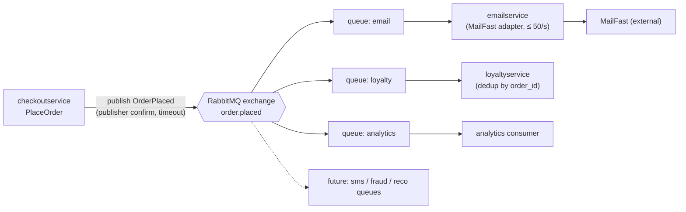

> Agent: Claude Code (Anthropic CLI), model Claude Opus 5.5 (`claude-opus-5-5`). Run `b` (with context): `docs/scenario.md`, `docs/adr/0001-use-redis-for-cart-storage.md`, `system/online-boutique/src/checkoutservice/main.go`

# ADR-0002: Publish an `OrderPlaced` event to RabbitMQ for post-order actions

- **Status:** Proposed
- **Date:** 2026-10-21
- **Deciders:** ยังไม่ระบุ (ดู Open questions)

## Context and problem

requirement R-12 (`docs/scenario.md`) กำหนดว่าหลังสั่งซื้อสำเร็จ ระบบต้องทำ 3 อย่าง:

1. ส่งอีเมลยืนยันผ่าน **MailFast** แทน logic จำลองใน `emailservice`
2. ให้ loyalty points ผ่าน `loyaltyservice` (service ใหม่)
3. บันทึก analytics event "order placed" ให้ marketing

ปีหน้าจะมีงานเพิ่มอีก ได้แก่ SMS, fraud scoring และ recommendations update

**วันนี้ทำงานอย่างไร (จากโค้ด)**

- `checkoutService.PlaceOrder` (`main.go` บรรทัด 230–280) ทำงานตามลำดับแบบ synchronous ผ่าน gRPC: `chargeCard` (252) → `shipOrder` (258) → `emptyUserCart` (263) → `sendOrderConfirmation` (273)
- ถ้าส่งอีเมลล้มเหลว ระบบแค่ `log.Warnf` แล้วคืนผลสำเร็จ (274) แต่ยังต้อง *รอ* อีเมลเสร็จก่อน เพราะใช้ `ctx` ของ request เดิมและไม่มี timeout แยก (`sendOrderConfirmation` บรรทัด 379–384)
- `checkoutservice` ไม่มี database ของตัวเอง struct `checkoutService` (66–86) มีแค่ gRPC client connection ทำ transactional outbox ในตัวมันไม่ได้ถ้าไม่เพิ่ม store ใหม่
- order id สร้างด้วย `uuid.NewUUID()` (233) ใช้เป็น idempotency key ได้
- `OrderResult` (265–271) **ไม่มี** `user_id` และยอดรวม `total` แต่ทั้งคู่มีอยู่ใน `PlaceOrder` แล้ว (`req.UserId`, `total` บรรทัด 243–250) ต้องใส่ลงใน event เอง เพราะ loyalty ต้องใช้คำนวณคะแนน **[Inferred]**
- มี tracing ผ่าน OpenTelemetry อยู่แล้ว (`otelgrpc`, `propagation.TraceContext` บรรทัด 134–140)

**ตัวเลขจาก `docs/scenario.md` และสิ่งที่ตามมา**

| Fact | ค่า | ผลต่อการออกแบบ |
|---|---|---|
| p95 ของ `PlaceOrder` | ≤ 500 ms (วันนี้ประมาณ 300 ms) | เหลือ headroom ประมาณ **200 ms** เท่านั้น |
| MailFast latency | p95 1.5 s, p99 8 s | เรียกแบบ synchronous ทำให้ p95 ประมาณ 1.8 s ซึ่ง**เกินเป้า 3.6 เท่า** |
| MailFast failure | ประมาณ 0.5 % ของ call | ช่วง peak ล้มประมาณ 1 อีเมล/วินาที ต้องมี retry |
| Peak vs. rate limit | 200 orders/s เทียบกับ MailFast 50 emails/s | ช่วง peak คิวอีเมลโตขึ้น **150 ข้อความ/วินาที** ต้องมี buffer ที่ทนทาน |
| Loyalty | ภายใน 1 นาที, **exactly once** | ต้องรับได้ ≥ 200 msg/s และกันคะแนนซ้ำ คิวของ loyalty ต้องไม่ติดคิวอีเมล |
| Availability | order ห้ามล้มเพราะ email, loyalty หรือ analytics ล่ม | การสั่งซื้อต้องไม่พึ่งงานหลังสั่งซื้อ |
| Team | 4 คน, เก่ง Go และ gRPC, 2 คนเคยใช้ RabbitMQ | |
| Ops | Kubernetes, ชอบ open-source และ self-hosted | |

## Decision drivers

1. **Availability:** order ต้องไม่ล้มเพราะ email, loyalty หรือ analytics ล่ม
2. **Performance:** p95 ของ `PlaceOrder` ≤ 500 ms ที่ 200 orders/s
3. **Reliability / correctness:** loyalty points ภายใน 1 นาที exactly once และอีเมลต้องไม่หายแม้ MailFast ล้ม 0.5 % หรือโดน rate limit 50/s
4. **Modifiability:** เพิ่ม SMS, fraud scoring และ recommendations update ปีหน้าได้โดยไม่ต้องแก้ `PlaceOrder` ทุกครั้ง
5. **Cost and team fit:** open-source, self-hosted บน Kubernetes และอยู่ในทักษะของทีม 4 คน (Go, gRPC, RabbitMQ)

## Considered options

1. **Synchronous gRPC calls in `PlaceOrder`:** ต่อยอดแบบวันนี้ เรียก `emailservice` (MailFast), `loyaltyservice` และ analytics ตามลำดับ
2. **In-process async goroutines in `checkoutservice`:** `PlaceOrder` สั่ง goroutine และคิวใน memory ให้ทำงานหลังสั่งซื้อ แล้วคืนผลทันที
3. **RabbitMQ (self-hosted) publish/subscribe:** `PlaceOrder` publish `OrderPlaced` ไปที่ exchange แบบ fanout หรือ topic consumer แต่ละรายมี queue ของตัวเอง
4. **Apache Kafka (self-hosted) event log:** `PlaceOrder` เขียน `OrderPlaced` ลง topic แล้ว consumer group แต่ละกลุ่มอ่านเอง

### Pros and cons of the options

| Option | Pros | Cons |
|---|---|---|
| 1. Sync gRPC | ไม่มี component ใหม่ ทีมถนัด gRPC อยู่แล้ว flow อ่านง่ายใน `PlaceOrder` | p95 ประมาณ 1.8 s **ผิดเป้า 500 ms** MailFast ช้า (p99 8 s) แล้ว checkout ช้าตาม ชน rate limit 50/s ที่ 200 orders/s ทุกงานใหม่ต้องแก้ `PlaceOrder` |
| 2. Goroutines | latency ต่ำ ไม่มี infra ใหม่ ทำได้เร็ว | งานใน memory **หายเมื่อ pod restart หรือ deploy** จึงไม่ผ่าน exactly once ของ loyalty backlog 150 msg/s ช่วง peak ค้างใน memory ของ pod หลาย replica คุม rate limit 50/s ร่วมกันยาก ยังต้องแก้ `checkoutservice` ทุกครั้งที่เพิ่มงาน |
| 3. RabbitMQ | buffer ทนทาน (durable queue) รับ backlog ช่วง peak ได้ queue แยกต่อ consumer อีเมลค้างแล้วไม่กระทบ loyalty เพิ่มงานใหม่แค่ bind queue ใหม่ open-source, self-hosted บน Kubernetes ได้ **2 คนในทีมเคยใช้** | component stateful ใหม่ที่ต้องดูแล ส่งแบบ at-least-once ต้องทำ idempotency เอง replay event ย้อนหลังไม่ได้เมื่อ ack แล้ว |
| 4. Kafka | throughput สูงมาก เก็บ event ไว้ replay ได้ (ดีกับ analytics และ consumer ใหม่ที่อยากอ่านย้อนหลัง) open-source | ไม่มีใครในทีมเคยใช้ ops หนักกว่า (partitions, consumer groups, retention) สำหรับทีม 4 คน 200 msg/s ไม่ต้องใช้ throughput ระดับ Kafka retry ทีละข้อความและ rate limit ต่อ consumer ทำยากกว่า queue |

## Decision

เลือก **Option 3: RabbitMQ (self-hosted บน Kubernetes) แบบ publish/subscribe**

- **Publisher:** แทนที่การเรียก `sendOrderConfirmation` (`main.go` บรรทัด 273–277) ด้วยการ publish `OrderPlaced` หลัง `shipOrder` สำเร็จ
  - event มี `order_id`, `user_id` (`req.UserId`), `email`, `items`, `total`, `shipping_cost` และ `transaction_id` (`txID`)
  - ใช้ publisher confirm และ timeout สั้นที่อยู่ใน headroom 200 ms (ค่าที่แน่นอนดู Open questions)
  - ถ้า publish ไม่สำเร็จ ให้ log error พร้อม `order_id` แล้วคืนผลสำเร็จเหมือนวันนี้ (driver 1)
- **Consumers:** แต่ละรายมี durable queue ของตัวเอง
  - `emailservice` เปลี่ยนเป็น adapter ที่เรียก MailFast จำกัดอัตราที่ **≤ 50/s รวมทุก replica** retry แบบ exponential backoff และส่งไป dead-letter queue เมื่อ retry หมด
  - `loyaltyservice` (Go และ gRPC ตามทักษะทีม) บันทึก `order_id` ที่ประมวลผลแล้วด้วย unique constraint ใน transaction เดียวกับการเพิ่มคะแนน ได้ผล **exactly once** จาก at-least-once delivery
  - analytics consumer ส่ง event ไปยังปลายทางของ marketing
- ส่ง trace context ใน message header เพื่อให้ trace ต่อเนื่องจาก `otelgrpc` เดิม (บรรทัด 134–140)

**เหตุผล:**

- เป็นทางเลือกเดียวที่ผ่าน driver 1–3 พร้อมกัน:
  - Option 1 ผิดเป้า latency
  - Option 2 ทำ exactly once ไม่ได้ และทำงานหายเมื่อ pod restart
- เมื่อเทียบกับ Kafka แล้ว RabbitMQ ตรงกับทักษะทีม (driver 5) มี per-queue retry, DLQ และ prefetch ที่เหมาะกับการคุม rate limit ของ MailFast และรองรับ 200 msg/s ได้สบาย **[Inferred]**: ยังไม่มีผล load test
- เหมือน ADR-0001 ที่ซ่อน store ไว้หลัง `ICartStore` ควรซ่อน broker ไว้หลัง interface `EventPublisher` ใน `checkoutservice` เพื่อให้เปลี่ยนไป Kafka ภายหลังได้ ถ้าต้องการ replay

## Consequences

- **Positive:**
  - `PlaceOrder` ไม่รอ MailFast อีกต่อไป p95 ควรใกล้เคียง 300 ms + เวลา publish (quality attribute: performance)
  - email, loyalty หรือ analytics ล่มแล้ว order ยังสำเร็จ ข้อความรออยู่ใน queue (quality attribute: availability)
  - backlog 150 msg/s ช่วง 11.11 ถูกเก็บใน durable queue แล้วระบายที่ 50/s โดยไม่ผิด rate limit (quality attribute: reliability)
  - queue แยกกันทำให้ loyalty ทำได้ภายใน 1 นาทีแม้คิวอีเมลยาว (quality attribute: performance, reliability)
  - งาน SMS, fraud scoring และ recommendations เพิ่มได้ด้วยการ bind queue ใหม่ ไม่แก้ `PlaceOrder` (quality attribute: modifiability)
  - การเปลี่ยน email provider กระทบแค่ `emailservice` (quality attribute: modifiability)
- **Negative:**
  - RabbitMQ เป็น component stateful ใหม่ ต้องดูแลเรื่อง cluster, persistent volume, upgrade และ monitoring (quality attribute: cost, operability)
  - อีเมลอาจถึงลูกค้าช้ามากในช่วง peak และลูกค้าเห็นคะแนนหลังสั่งซื้อไม่ทันที (quality attribute: usability, eventual consistency)
    - ตัวอย่างการคำนวณ **[Inferred]**: ถ้า peak นาน 10 นาที (สมมติ ไม่ใช่ข้อมูลจาก scenario) คิวจะค้าง 150 × 600 = 90,000 อีเมล ใช้เวลาระบายอย่างน้อย 90,000 / 50 = 30 นาทีหลัง peak
  - schema ของ `OrderPlaced` กลายเป็น contract ของหลาย consumer ต้องมี versioning (quality attribute: modifiability)
  - debug ข้าม service แบบ asynchronous ยากขึ้น ต้องพึ่ง trace context ใน header (quality attribute: testability, observability)
- **Risks and mitigations:**
  - *event หายถ้า broker ล่มตอน publish (dual-write):* `checkoutservice` ไม่มี DB ให้ทำ outbox
    - mitigation: ใช้ RabbitMQ แบบ replicated (quorum queues) และ log `order_id` ทุกครั้งที่ publish ล้ม เพื่อ reconcile
    - ถ้ายอมรับ event หายไม่ได้เลย ต้องเพิ่ม outbox store (ต้องตัดสินใจ ดู Open questions)
  - *publish ช้ากิน latency budget:* ตั้ง timeout ของ publish และวัด p95 ของ `PlaceOrder` ใน load test
  - *คะแนนซ้ำจาก redelivery:* ใช้ unique constraint บน `order_id` ใน `loyaltyservice` (ต้องเลือก DB ของ loyalty)
  - *อีเมลซ้ำ:* consumer เก็บ `order_id` ที่ส่งแล้ว และใช้ idempotency key ของ MailFast ถ้ามี (ดู Open questions)
  - *MailFast ล่มนาน:* DLQ, alert เมื่อ queue depth หรือ message age เกินเกณฑ์ และ replay จาก DLQ
  - *ทีมเล็ก (4 คน) ต้องดูแล broker:* ใช้ RabbitMQ Cluster Operator บน Kubernetes **[Inferred]**: open-source, ยังไม่ได้ตรวจกับทีม ops และมี 2 คนที่เคยใช้ RabbitMQ เป็นเจ้าของหลัก

## Validation

- **Load test 200 orders/s** (เช่น ใช้ `loadgenerator` แบบ ADR-0001) พร้อม MailFast stub ที่จำลอง p95 1.5 s, p99 8 s, ล้ม 0.5 % และ rate limit 50/s
  - p95 ของ `PlaceOrder` ≤ 500 ms
  - ไม่มีคำตอบ 429 หรือ rate-limit error จาก MailFast stub
  - **ทุก** order ได้ loyalty points ภายใน 60 s (วัดจาก timestamp ของ event ถึงเวลาบันทึกคะแนน)
- **Failure injection:** ปิด `emailservice`, `loyaltyservice` และ analytics consumer ทีละตัว อัตราการสั่งซื้อสำเร็จต้องเป็น 100 % เมื่อเปิดกลับมา queue ต้องระบายจนหมด
- **Exactly-once test:** ส่ง `OrderPlaced` ซ้ำโดยตั้งใจ และ kill consumer ก่อน ack จำนวนคะแนนต่อ `order_id` ต้องเท่ากับ 1 เสมอ
- **Modifiability check:** เพิ่ม consumer จำลอง "sms" โดยไม่แก้ `checkoutservice` diff ใน `checkoutservice` ต้องเป็น 0 บรรทัด
- **Metrics ใน production:** queue depth, oldest-message age, DLQ size และ p95 ของ `PlaceOrder`
- **Review:** ทบทวนหลัง 11.11 sale ครั้งแรก และก่อนเริ่มงาน fraud scoring

## Open questions

ข้อมูลเหล่านี้ไม่มีใน context จึงไม่ได้สมมติค่าขึ้นเอง:

1. **Peak duration:** 200 orders/s ช่วง 11.11 นานเท่าไร ใช้คำนวณขนาด backlog อีเมลและ disk ของ RabbitMQ
2. **Email delivery target:** ยอมให้อีเมลยืนยันช้าได้นานสุดเท่าไรในช่วง peak ต้องขอเพิ่ม rate limit ของ MailFast หรือไม่
3. **Event loss tolerance:** ถ้า broker ล่มตอน publish ยอมให้ event หายได้หรือไม่ ถ้าไม่ได้ ต้องเพิ่ม outbox store ให้ `checkoutservice`
4. **Publish timeout budget:** ใช้ headroom 200 ms ได้เท่าไรสำหรับ publish
5. **MailFast API:** โปรโตคอล (REST หรือ SMTP), มี idempotency key หรือ webhook แจ้ง bounce หรือไม่, rate limit นับต่อ account หรือต่อ IP, ค่าใช้จ่าย
6. **Loyalty:** สูตรคำนวณคะแนน, ใช้ data store อะไร, ต้องหักคืนเมื่อยกเลิกหรือคืนสินค้าหรือไม่
7. **Analytics:** ปลายทางของ marketing คือระบบอะไร และ schema ของ event ที่ต้องการ
8. **Fraud scoring ปีหน้า:** ต้อง *ขวาง* order ก่อนยืนยัน (synchronous) หรือแค่ตรวจหลังสั่งซื้อ ถ้าต้องขวาง จะอยู่นอกขอบเขตของ ADR นี้
9. **Privacy:** ข้อกำหนดการส่งอีเมลและข้อมูลลูกค้าให้ MailFast และ analytics
10. **Deciders:** ใครเป็นผู้อนุมัติ ADR นี้
